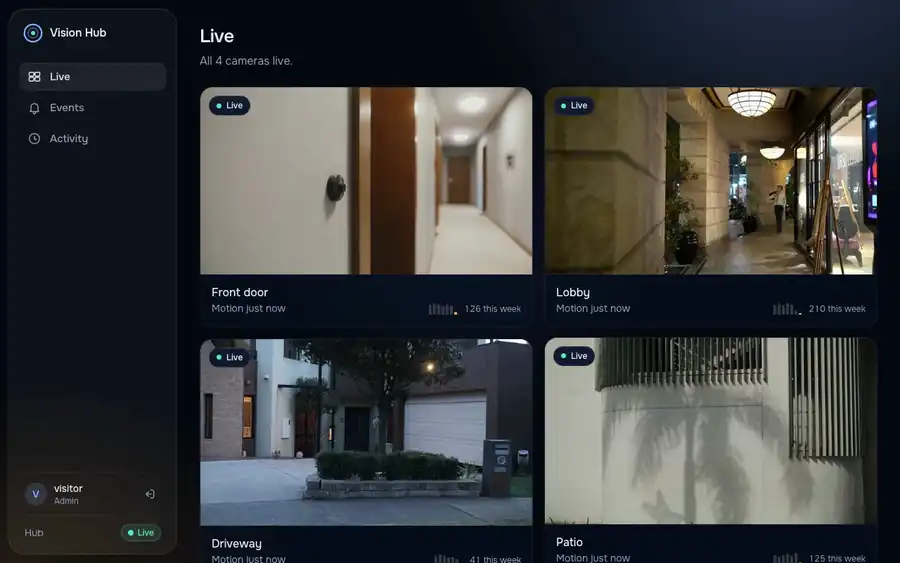
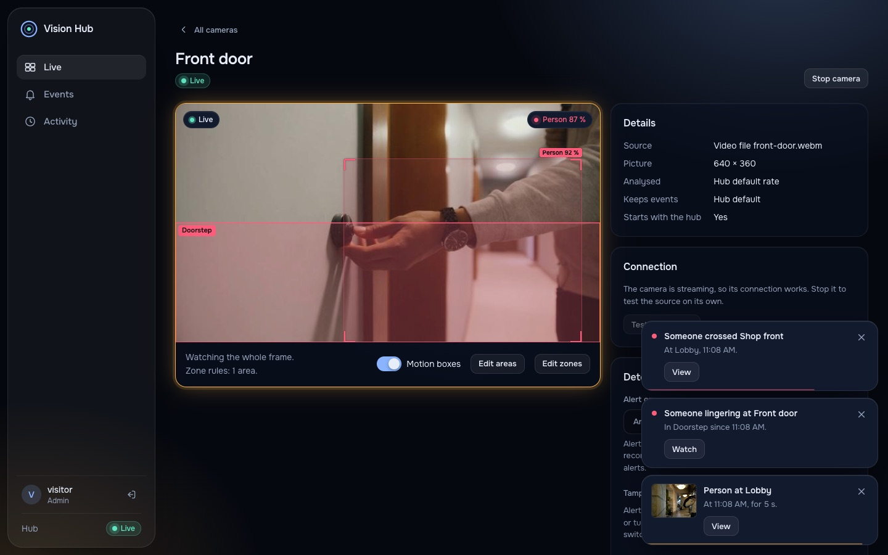
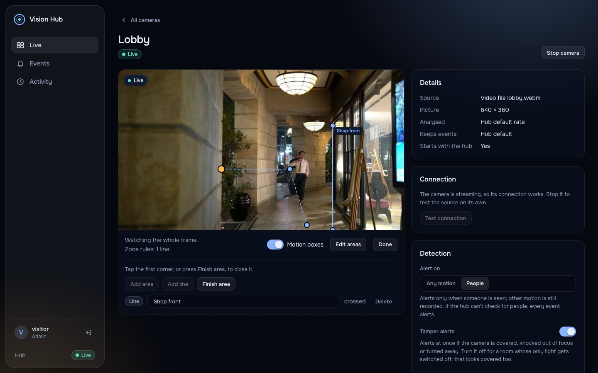
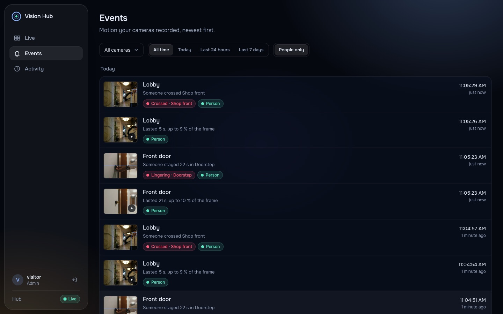
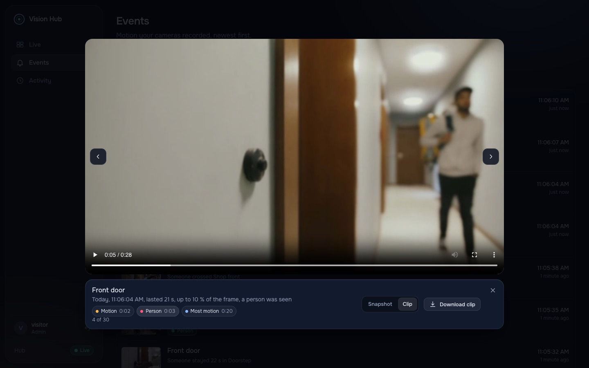
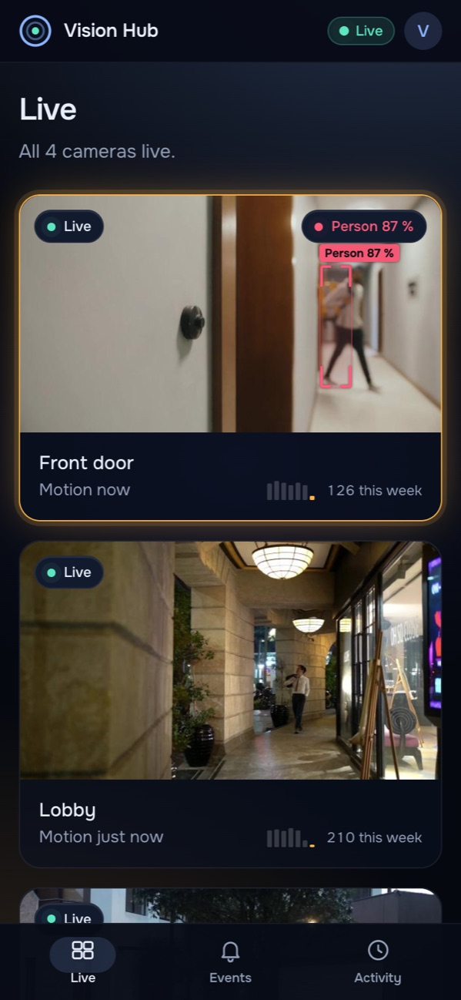
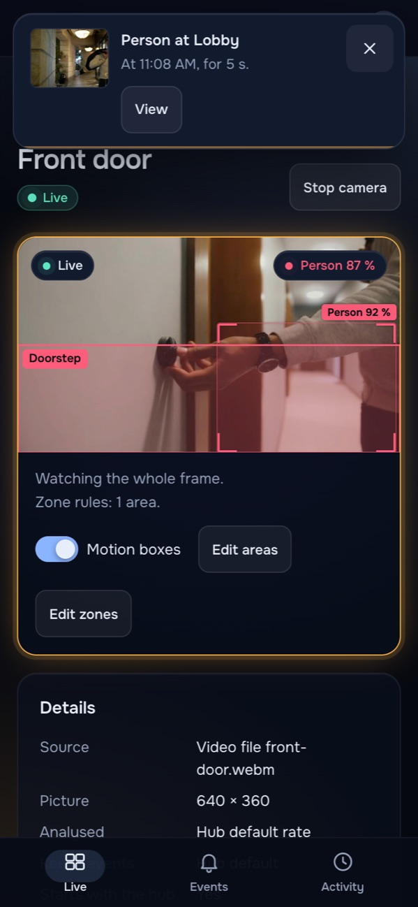
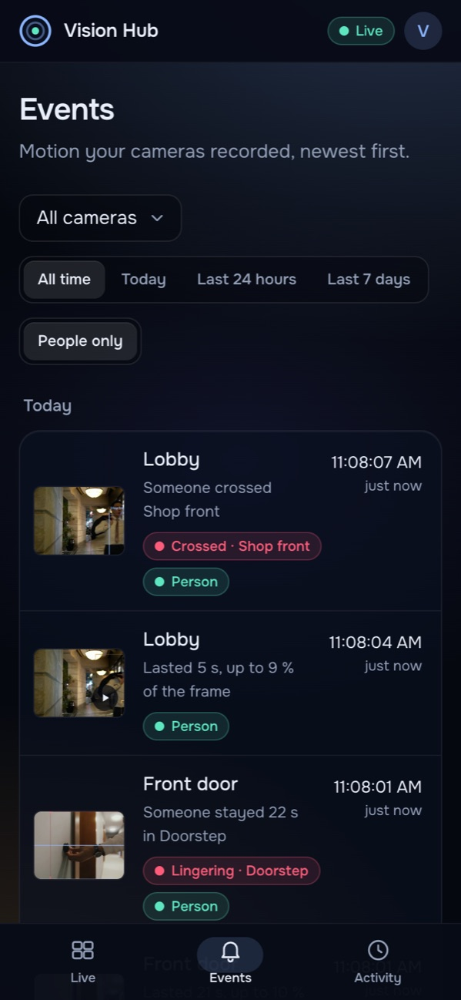
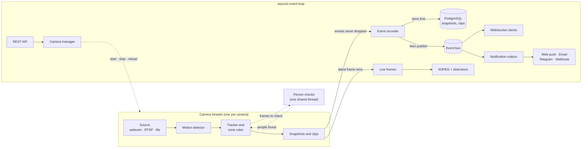

<div align="center">

<h1>IoT Vision Hub</h1>

<p><strong>A self-hosted security hub for the cameras you already own.</strong><br />
It tells people from shadows, follows them across the frame, and alerts your phone within a
second, with the clip to prove it.</p>

<p>
  <a href="https://andrewtechtips.github.io/iot-vision-hub/"><strong>Live demo</strong></a>
  &nbsp;·&nbsp;
  <a href="#quick-start">Quick start</a>
  &nbsp;·&nbsp;
  <a href="#how-it-works">How it works</a>
  &nbsp;·&nbsp;
  <a href="#documentation">Documentation</a>
</p>

<p>
  <a href="https://github.com/AndrewTechTips/iot-vision-hub/actions/workflows/ci.yml"></a>
  <a href="https://github.com/AndrewTechTips/iot-vision-hub/actions/workflows/demo.yml"></a>
  <a href="https://github.com/AndrewTechTips/iot-vision-hub/pkgs/container/iot-vision-hub"></a>
  
  
</p>

</div>

<p align="center">
  <a href="https://andrewtechtips.github.io/iot-vision-hub/"></a>
</p>

The hub pulls video from webcams, RTSP cameras or video files, finds motion, checks it for
people with a model that runs locally, and keeps every event with its snapshots and a short clip.
A dashboard that installs as an app shows it all live. Nothing leaves your network unless you
want alerts outside it.

**The [live demo](https://andrewtechtips.github.io/iot-vision-hub/)** is the real dashboard,
running in your browser against a recording of what the hub saw on four cameras of real footage.
Every page works, from the live view to the zone editor.

## Highlights

- **People, not shadows.** Each event is checked with YOLOX-s, locally. A camera can alert on
  any motion or on people only, so the car and the swaying tree stay quiet.
- **Tracking and zone rules.** Each person keeps an id from frame to frame, even standing still.
  Draw an area or a line on the picture: someone lingering at the door, or crossing into the
  garden, alerts at once.
- **Alerts that arrive.** Web push to your phone, email, Telegram or a signed webhook. Alerts
  are stored before they are sent and retried across restarts, never silently lost.
- **Evidence.** Every event keeps a clean and an annotated snapshot and a WebM clip that starts
  before the motion, with buttons that jump to the moment the person appeared.
- **Tamper alerts.** A camera covered, knocked out of focus or turned away raises a red alert
  until it sees normally again.
- **Runs anywhere.** One Docker image for amd64 and arm64, a Raspberry Pi included, read-only,
  as a non-root user.

## Screenshots

<table>
  <tr>
    <td width="50%"></td>
    <td width="50%"></td>
  </tr>
  <tr>
    <td><sub><b>A camera page.</b> The dashboard draws what the hub found on each frame: the person's whole body and score, and the zone whose rule is firing.</sub></td>
    <td><sub><b>Zone editor.</b> Tap an area's corners or a line's two ends on the live picture, then name it and set how long someone may stay.</sub></td>
  </tr>
  <tr>
    <td></td>
    <td></td>
  </tr>
  <tr>
    <td><sub><b>History.</b> Every event with its thumbnail, filtered by camera, time or people, updating as things happen.</sub></td>
    <td><sub><b>Clip viewer.</b> The clip starts before the detection; the buttons jump to the motion, the person found and the busiest frame.</sub></td>
  </tr>
</table>

<p align="center">
  
  &nbsp;
  
  &nbsp;
  
  <br />
  <sub>The same dashboard on a phone, installed as an app, with notifications even when it is closed.</sub>
</p>

<sub>The cameras are the demo's: real footage of a front door, a lobby, a driveway and a patio
(free clips from Pexels, see [docs/demo-footage.md](docs/demo-footage.md)). All four alert on
people only.</sub>

## Quick start

You need Docker. The image is published for amd64 and arm64, and brings the hub, the dashboard
and the person model; PostgreSQL runs next to it.

```bash
git clone https://github.com/AndrewTechTips/iot-vision-hub.git
cd iot-vision-hub
docker compose pull
docker compose up --wait
docker compose exec api vision-hub create-user admin --role admin
```

Open **http://localhost:8000** and sign in. To look around without cameras, start the demo
cameras instead, four scenes of real footage fetched on the first start (about 12 MB):

```bash
docker compose -f docker-compose.yml -f docker-compose.demo.yml up --wait
```

Your own cameras go in a `devices.toml` like [`devices.example.toml`](devices.example.toml),
mounted into the container (see the comment in `docker-compose.yml`); after the first start they
are managed from the dashboard. On a Raspberry Pi, follow
[docs/raspberry-pi.md](docs/raspberry-pi.md). To build the image from the checkout instead, use
`docker compose up --build --wait`.

**On your phone**, browsers allow notifications and installing only on secure pages: reach the
hub over HTTPS (a reverse proxy, or a tunnel such as Tailscale) or on `localhost`. Then choose
**Install app** (*Add to Home Screen* on an iPhone) and turn on **Notifications**.

<details>
<summary><b>Running from source</b></summary>

You need [uv](https://docs.astral.sh/uv/) (it installs Python 3.14), Node.js 22.12+ and
PostgreSQL:

```bash
docker run -d --name vision-hub-db -p 127.0.0.1:5432:5432 \
  -e POSTGRES_USER=vision_hub -e POSTGRES_PASSWORD=vision_hub -e POSTGRES_DB=vision_hub \
  postgres:17-alpine
uv sync
uv run vision-hub create-user admin --role admin    # migrates the database, asks for a password
uv run vision-hub download-model                    # the person detector (36 MB)
uv run vision-hub demo-footage                      # the demo cameras' footage (12 MB)
(cd frontend && npm ci && npm run build)
VISION_HUB_VISION__DEVICES_FILE=devices.demo.toml \
  VISION_HUB_APP__DASHBOARD_DIR=frontend/dist uv run vision-hub serve
```

The dashboard is at **http://localhost:8000** and the interactive API docs at
**http://localhost:8000/docs**. For the dashboard with hot reload, run `npm run dev` in
`frontend/` and open **http://localhost:5173**; it proxies the API to the hub. After changing the
API, `npm run api:sync` regenerates the dashboard's types.

</details>

## Features

**Detection**
- Any camera: USB webcams, RTSP cameras that reconnect on their own, video files and a built-in
  simulator, each on its own thread so nothing blocks the API.
- Motion detection that holds up outdoors: a background that adapts to dusk and passing clouds,
  a reset instead of an alarm when the lights switch on, regions to watch drawn on the picture,
  and one event per visit instead of one per flicker.
- Person detection with YOLOX-s on ONNX Runtime, on one background thread shared by all cameras.
- Object tracking across frames, with whole-body boxes for people and still people kept.
- Zone rules on people's feet: lingering in an area for N seconds, crossing a line.
- Tamper detection: covered, blurred or moved cameras, measured against their usual view.

**Alerts**
- Web push (RFC 8291 encryption, VAPID), email with the snapshot, Telegram with the snapshot,
  and JSON webhooks signed with HMAC-SHA256 ([docs/integrations.md](docs/integrations.md)).
- An outbox in the database: at-least-once delivery, retries with growing delays, a cooldown
  per camera, and alerts in your time zone with a link to the event.

**History**
- Every event with clean and annotated snapshots, a thumbnail and a clip, downloadable as
  evidence and deleted on a per-camera schedule.
- When each camera sees motion or people, over four weeks, as a weekday-by-hour heatmap; the
  database does the counting.
- An audit log of who changed which camera or account.

**Dashboard**
- Live view, camera pages, history, clip viewer, zone and area editors, settings and the audit
  log, in vanilla JavaScript without a framework.
- Detections arrive as data with each video frame and are drawn by the dashboard, so the boxes
  match the picture and the video stays clean.
- Real time over a WebSocket, with a replay of everything missed while offline.
- An installable app that still starts when the hub is down; works from the keyboard and passes
  an automated WCAG 2.2 AA audit on every page.

**Operations**
- One Docker image (amd64, arm64) built and smoke-tested per architecture, with a provenance
  attestation; a non-root user on a read-only filesystem, health checks and graceful shutdown.
- Short-lived tokens with rotating refresh tokens, roles, rate-limited login, signed media
  links, encrypted camera passwords and a strict content security policy. Production settings
  refuse to start when something unsafe is left on.
- Prometheus metrics per camera (frame rate, time per frame, frame age) and for alerts, HTTP
  and event-loop lag.

## How it works



Everything heavy (capture, decoding, detection, encoding) runs in threads; OpenCV releases the
GIL, so cameras run in parallel and the event loop only moves bytes. A test runs live cameras with
asyncio's debug mode flagging any callback slower than 50 ms, and finds none.

A person check takes about 0.3 s of a core, far too long for a camera thread, so checks run on
one background thread for every camera and their answers label the tracks. Tracking itself costs
under 10 µs a frame. The measurements behind these choices are in
[docs/performance.md](docs/performance.md), and the design decisions in
[ROADMAP.md](ROADMAP.md).

| Layer | Built with |
|---|---|
| API | FastAPI, Pydantic v2, async SQLAlchemy 2, Alembic, PostgreSQL |
| Vision | OpenCV 5, NumPy, ONNX Runtime (YOLOX-s), VP8/WebM clips |
| Real time | WebSockets, MJPEG with per-frame detections, an in-process event bus |
| Alerts | Web Push (RFC 8291, VAPID), SMTP, Telegram Bot API, signed webhooks |
| Dashboard | Vanilla JavaScript (ES modules) with JSDoc types, Vite, Tailwind CSS v4, a service worker |
| Quality | pytest, mypy (strict), Ruff, Vitest, TypeScript checks, Playwright, axe, Lighthouse |
| Delivery | Docker (amd64, arm64), Docker Compose, GitHub Actions, GHCR, GitHub Pages |

<details>
<summary><b>Project layout</b></summary>

```
src/vision_hub/
├── core/       settings, logging, security, errors, service container
├── api/        FastAPI routers, dependencies, middleware, the dashboard's static files
├── schemas/    request, response and WebSocket models
├── domain/     domain models and ports (Protocols)
├── services/   auth, devices, events, notifications, push, audit, health
├── vision/     sources, motion, tracking, zones, tamper, clips, person checks, camera workers
├── realtime/   WebSocket connections and MJPEG streaming
└── infra/      database, file storage, event bus, alert channels, rate limiting
frontend/
├── src/        the dashboard: views, UI components, API client, realtime, the demo hub
├── sw/         service worker (offline start, notifications)
└── e2e/        Playwright tests against a real hub and against the demo, desktop and phone
```

</details>

### The live demo

On every push to `main`, [`demo.yml`](.github/workflows/demo.yml) fetches the four clips,
runs each through the real camera worker, motion detector, tracker and person model with
`vision-hub export-demo`, and records what the hub saw: the boxes and tracked people on every
frame, each event with its snapshots and clip, each zone rule that fired. The dashboard is then
built with a small hub in [`frontend/src/demo/`](frontend/src/demo) that answers the API, the
WebSocket and the video streams from that recording. It is typed against the OpenAPI schema, so it
cannot drift from the real API. Playwright checks the result on desktop and phone before GitHub
Pages serves it.

## Configuration

Settings are environment variables prefixed with `VISION_HUB_`, with `__` between a group and a
field (`VISION_HUB_SMTP__PASSWORD`). Every option is documented in
[`.env.example`](.env.example). The ones you are most likely to set:

| Setting | What it does |
|---|---|
| `VISION_HUB_VISION__DEVICES_FILE` | A TOML file that seeds cameras the database does not have yet |
| `VISION_HUB_SMTP__ENABLED`, `__USERNAME`, `__PASSWORD` | Email alerts (Gmail works with an App Password) |
| `VISION_HUB_TELEGRAM__ENABLED`, `__BOT_TOKEN`, `__CHAT_IDS` | Telegram alerts ([setup](docs/integrations.md#telegram)) |
| `VISION_HUB_WEBHOOK__ENABLED`, `__URL`, `__SECRET` | Signed JSON alerts to your URL ([payload](docs/integrations.md#webhook)) |
| `VISION_HUB_NOTIFICATIONS__TIMEZONE` | Time zone of alert texts, such as `Europe/Bucharest` |
| `VISION_HUB_APP__PUBLIC_URL` | Where the dashboard is reached; alerts link to the event there |
| `VISION_HUB_STORAGE__RETENTION_DAYS` | How long events are kept (30 days; cameras can override it) |
| `VISION_HUB_SECURITY__ALLOWED_HOSTS` | Host names the hub answers to, when reached from other devices |

Detection is set per camera, from its page in the dashboard or the API: sensitivity, regions to
watch, zone rules, whether to alert on any motion or on people only, and tamper alerts.

<details>
<summary><b>Production notes</b></summary>

- With `VISION_HUB_APP__ENV=prod`, the hub refuses to start without an explicit JWT secret,
  encryption keys and database password, and rejects debug mode, wildcard CORS or hosts,
  unencrypted SMTP and unsigned webhooks.
- **Encryption at rest:** set `VISION_HUB_SECURITY__ENCRYPTION_KEYS`; outside production a key
  file is created once in `data/`. Back it up, or stored camera passwords cannot be decrypted.
- **Users:** `vision-hub create-user NAME --role admin|viewer` creates them and resets
  passwords; `VISION_HUB_SECURITY__ADMIN_PASSWORD_HASH` creates the admin on first start.
- **Push notifications** sign with a VAPID key (`vision-hub vapid-key` prints one) and only
  POST to the browsers' own push services. Set `VISION_HUB_PUSH__SUBJECT` to a `mailto:`
  contact; Safari requires one.
- **Event clips** cost 6–17 % of a core per camera while an event is open and nothing between
  events; `VISION_HUB_CLIPS__WIDTH=480` halves that.
- **Metrics:** `GET /metrics` serves Prometheus metrics; set `VISION_HUB_METRICS__TOKEN` (32+
  characters) and give Prometheus the same bearer token.
- **Shutdown:** `SIGTERM` drains gracefully; requests still open after
  `VISION_HUB_APP__SHUTDOWN_TIMEOUT_SECONDS` (10) are cancelled, so give containers more than
  that (compose uses 30 s).
- **Migrations** run on startup.

</details>

## API

A versioned REST API under `/api/v1`, documented with OpenAPI at `/docs`. Errors are always
[RFC 9457](https://www.rfc-editor.org/rfc/rfc9457) `application/problem+json` with a
`request_id` that matches the server logs; the conventions are in
[docs/api-conventions.md](docs/api-conventions.md).

<details>
<summary><b>Endpoints</b></summary>

| Endpoint | Purpose | Access |
|----------|---------|--------|
| `POST /auth/token` · `/refresh` · `/logout` | OAuth2 login, refresh-token rotation, logout | public, rate limited |
| `GET /auth/me` · `POST /auth/tickets` | Current user · single-use ticket for browsers | signed in |
| `GET /devices` · `/devices/{id}` | Cameras with live status, tampering and lingering now | signed in |
| `POST` · `PATCH` · `DELETE /devices[/{id}]` | Add, update, remove cameras | admin |
| `POST /devices/{id}/start` · `/stop` | Run or stop a camera | admin |
| `PUT /devices/{id}/detection-config` | Detection settings and zone rules, applied live | admin |
| `POST /devices/test` | Check a source works before saving it | admin |
| `GET /devices/{id}/snapshot` · `/stream` | Latest frame · MJPEG stream with detections | signed in or ticket |
| `GET /events` · `/events/{id}` | Event history, filtered by camera, time and people | signed in |
| `GET /events/activity` | Events per camera and hour, counted by the database | signed in |
| `GET /events/{id}/snapshot` · `/clip` | Event images and clip, with byte ranges | bearer or signed link |
| `GET /audit` | Who changed which device or user, and when | admin |
| `GET /push` · `POST /push/subscriptions` · `POST /push/test` | Web push key, subscribe a browser, test it | signed in |
| `WS /ws/events` | Live events and camera status, with replay | ticket |
| `GET /health/live` · `/ready` | Probes for Docker and Kubernetes | public |

Browsers can't send an `Authorization` header with a WebSocket or an ``, so they exchange
their token for a short-lived, single-use ticket first:

```js
const { ticket } = await (await fetch("/api/v1/auth/tickets", { method: "POST", headers })).json();
const ws = new WebSocket(`wss://${location.host}/api/v1/ws/events?ticket=${ticket}`);
ws.onmessage = ({ data }) => {
  const message = JSON.parse(data); // {type, v, ts, device_id, data}
  if (message.type === "ping") ws.send(JSON.stringify({ type: "pong" }));
  if (message.type === "motion.started") console.log(`Motion on ${message.device_id}`);
};
```

</details>

## Quality

```bash
uv run ruff check && uv run mypy && uv run pytest   # lint, strict types, 1,000+ tests at 99 % coverage
cd frontend && npm run check                        # ESLint, Prettier, types, unit tests
npm run build && npm run e2e                        # Playwright against a real hub, desktop and phone
npm run build:demo && npm run e2e:demo              # the public demo, after export-demo
```

- **Backend:** unit and integration tests on SQLite and PostgreSQL, with real video encoding,
  the real person model on footage of someone walking in, push encryption checked against the
  RFC's own example, a real SMTP server, and a camera event travelling all the way to a signed
  webhook.
- **Dashboard:** end-to-end tests start a throwaway hub with simulated cameras and go through
  sign-in, live video, alerts (on screen 0.2 to 0.5 s after the hub closes an event), clips, zone
  editing, notifications, offline start, keyboard-only use and an accessibility audit of every
  page.
- **Load:** 5 cameras, 20 WebSocket clients, 2 video viewers and steady API traffic keep the
  event loop's lag at 2 ms (p99).
- **Lighthouse (mobile):** performance 95 to 100, accessibility 100, best practices 100.

GitHub Actions runs all of it on every push, then publishes the image and the demo.

## Security

- Passwords are hashed with Argon2. Access tokens last 15 minutes; refresh tokens rotate, and
  reusing an old one is caught, even across restarts.
- Video and WebSocket requests use single-use tickets; snapshots and clips use signed links that
  expire after an hour.
- Camera passwords are encrypted at rest and never returned by the API.
- Outbound requests can't be aimed at unexpected hosts: push only reaches the browsers' push
  services, and no alert channel follows redirects. Webhooks are signed; the Telegram token never
  appears in logs.
- The dashboard runs under a strict content security policy, and the API refuses unknown `Host`
  headers.
- Dependencies are checked with `pip-audit` and `npm audit`, and kept current by Dependabot.

## Documentation

| | |
|---|---|
| [ROADMAP.md](ROADMAP.md) | Design decisions and the development log |
| [docs/performance.md](docs/performance.md) | Where the CPU goes, and how the hub was tuned |
| [docs/integrations.md](docs/integrations.md) | Telegram, webhooks and Home Assistant |
| [docs/raspberry-pi.md](docs/raspberry-pi.md) | Running the hub on a Raspberry Pi |
| [docs/api-conventions.md](docs/api-conventions.md) | The rules every endpoint follows |
| [docs/demo-footage.md](docs/demo-footage.md) | The demo cameras' footage: sources, credits, selection |

## Background

It started as a single OpenCV script, *Thief Detection Notifier*: watch the webcam, and when
something moves, email a photo. It worked, mostly. One person walking past sent five emails,
every sunset "moved", and I could only see what happened from my laptop.

So I rebuilt it as a service: any number of cameras, detection in its own threads, a history of
every event with a clip, and a dashboard that works as an app on my phone. The old script is
still in the git history, and its lessons (debounced events, a background that adapts to the
light, alerts that never get lost) shaped most of the design.

## Contact

Andrei Condrea · [LinkedIn](https://www.linkedin.com/in/andrei-condrea-b32148346) ·
condrea.andrey777@gmail.com

Designed and built end to end, from the camera threads to the dashboard.
